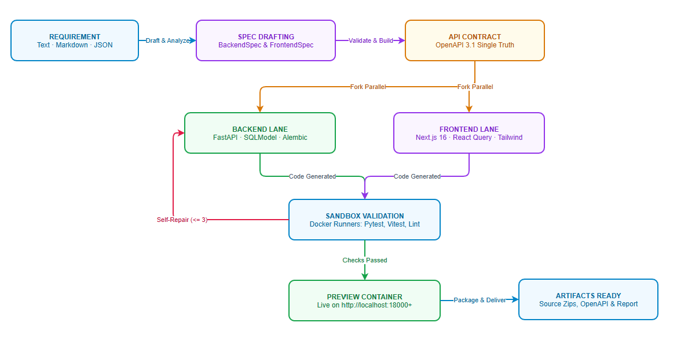
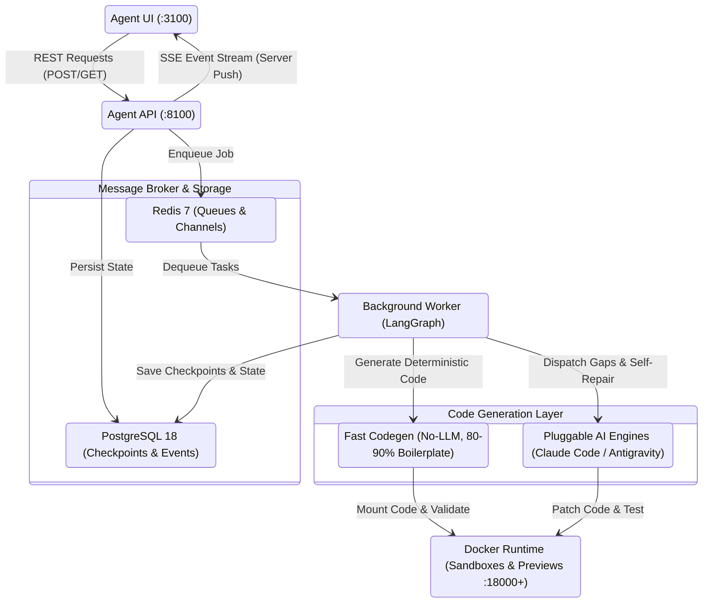
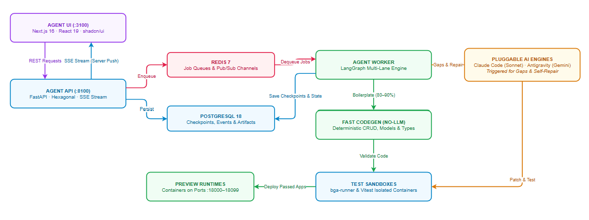

# Fullstack Generation Agent

The **Fullstack Generation Agent** is an autonomous AI-powered software generation platform. It transforms natural-language requirements, Markdown documents, Frontend-Agent site JSON, or structured JSON specifications into production-grade, tested **FastAPI** backends and **Next.js 16** frontends, running them as live containerized applications with real-time observability.

---

## 1. Overview

Building modern fullstack applications typically requires hours of repetitive scaffolding, contract negotiation, database migration writing, and boilerplate setup. The Fullstack Generation Agent automates this end-to-end lifecycle through a hybrid architecture combining **fast deterministic code generation** with **pluggable AI coding engines**:

- **Contract-First Parallel Generation:** In dynamic mode, a single OpenAPI 3.1 contract is established as the single source of truth. Both the Next.js frontend and FastAPI backend are generated concurrently against this contract.
- **Pluggable Coding Engines:** Seamlessly switch between **Claude Code CLI** (Anthropic Claude 5.5 Sonnet) and **Google Antigravity CLI** (`agy` with Gemini 3.8 models), or use the built-in **Fake Engine** for instant offline verification without API costs.
- **Hybrid No-LLM Acceleration:** Deterministic Python code generators instantly produce 80–90% of standard application boilerplate (TypeScript interfaces, Zod form schemas, React Query hooks, MSW mock fixtures, SQLModel entities, Alembic migrations, and CRUD routers) with zero LLM latency and zero token cost. LLM engines focus exclusively on architectural planning, custom business rules, and specialized interactive components.
- **Automated Sandbox Verification & Self-Repair:** Every generated service is validated in isolated Docker runner containers (`bga-runner` for Python, `bga-runner-node` for Node.js). If linting or test suites fail, the engine enters an iterative self-repair loop to automatically fix errors.
- **Live Container Previews:** Successfully generated applications are automatically started in isolated Docker preview containers on dedicated local ports (`18000–18099`), allowing immediate interactive testing via **Open site** in the UI.
- **Real-Time Observability:** Stream live generation steps and logs over Server-Sent Events (SSE) with monotonic sequence IDs and automatic reconnection replay, accompanied by span waterfall tracing, token accounting, and optional LangSmith integration.

---

## 2. Prerequisites

### 2.1 System Requirements
- **Operating System:** Linux or macOS (WSL 2 on Windows is fully supported).
- **Memory & Storage:** 8 GB+ RAM recommended; at least 15 GB free disk space for Docker runner images and workspaces.

### 2.2 Installed Software
| Tool | Minimum Version | Purpose |
|---|---|---|
| **Docker & Docker Compose** | v2.20+ | Multi-container stack, isolated test sandboxes, and preview runtimes |
| **Python** | 3.12+ | API control plane, worker orchestration, and sandbox testing |
| **uv** | v0.4+ | Fast Python virtual environment and dependency manager |
| **Node.js & pnpm** | Node 22+, pnpm 10+ | Next.js Agent UI and generated frontend tooling |
| **Git & Make** | Standard | Workspace version control checkpoints and development workflow targets |

### 2.3 Credentials & API Keys
Configure at least one coding engine in `.env` (generated via `make env`):
- **Claude Code (Anthropic):** `ANTHROPIC_API_KEY`, or your subscription credentials mounted via `CLAUDE_CREDENTIALS_HOST_FILE`.
- **Google Antigravity (`agy`):** `GEMINI_API_KEY` or Google Cloud ADC (`AGY_ADC_AUTH=true`) when running in Docker. When using local account login (`ANTIGRAVITY_AUTH=account`), a dedicated host worker is spawned automatically to access the OS keyring.
- **Photo Synthesis (Optional):** `GEMINI_IMAGE_API_KEY` for generating WebP photos with `gemini-3.1-flash-lite-image`.
- **LangSmith Tracing (Optional):** `LANGSMITH_API_KEY` and `LANGSMITH_TRACING=true` for tracing execution graphs in LangSmith.

### 2.4 Default Port Allocations
- **Agent UI:** `http://localhost:3100`
- **Agent API & OpenAPI Docs:** `http://localhost:8100` / `http://localhost:8100/docs`
- **PostgreSQL 18:** `5442` (localhost dev binding)
- **Redis 7:** `6389` (localhost dev binding)
- **Preview Containers:** `18000–18099`

---

## 3. Main Business Workflow

The agent guides requirements through a structured state workflow:


[](docs/diagrams/business-workflow.png)


1. **Requirement Ingestion:** Submit natural language prompts, upload Markdown requirement documents, or import FrontendSpec / BackendSpec JSON. Choose your generation mode (`dynamic`, `static`, or `backend`) and coding engine.
2. **Spec Drafting & Analysis:** The background worker runs `DraftRunner` to synthesize structured `backend-spec.json` and `frontend-spec.json`, select cohesive design directions (palettes, fonts, layout presets), and schedule SVG vector or photo assets.
3. **Validation & Contract Review:** Validates schemas with Pydantic v2 and performs cross-spec parity checks (`check_spec_pair`). Generates an immutable OpenAPI 3.1 contract (`.bga/contract.json`) as the single source of truth for user review and approval.
4. **Parallel Generation Execution:** Dynamic mode launches dual execution lanes:
   - **Frontend Lane:** Fast deterministic codegen creates TypeScript interfaces, Zod schemas, React Query hooks, and MSW mocks; the engine creates custom interactive components.
   - **Backend Lane:** Fast deterministic codegen creates SQLModel entities, Alembic migrations, repository ports/adapters, use cases, and routers; the engine writes custom business rules.
5. **Sandbox Testing & Iterative Self-Repair:** Isolated runner containers execute linters (Ruff/ESLint), typecheckers, unit tests, and Playwright smoke tests. Failures trigger an automated self-repair loop that analyzes compiler diagnostics and edits implicated files.
6. **Live Preview & Delivery:** Switches the frontend to the real backend (`MOCK_TEST_API=false`), spins up preview containers on allocated ports (`18000+`), and packages downloadable artifacts (`backend.zip`, `frontend.zip`, `openapi.json`, `report.json`).

📖 **Read the full developer workflow guide:** [`docs/business-workflow.md`](docs/business-workflow.md)

---

## 4. Technical Architecture Highlights

The Fullstack Generation Agent architecture is organized into clean, decoupled components:



[](docs/diagrams/technical-architecture.png)


- **Hexagonal FastAPI Control Plane:** Adheres to Clean Architecture with strict separation between Domain Entities, ORM Models, Ports, and Presenter Routers.
- **LangGraph Multi-Lane Orchestration:** Built on `langgraph.graph.StateGraph` with parallel subgraph compilation, conditional routing, and Git commit checkpoints (`node:<name> attempt:<N>`) for rollback recovery.
- **Zero-Loss SSE Event Streaming:** Combines PostgreSQL sequential event persistence with Redis Pub/Sub. Clients reconnecting with `Last-Event-ID` receive historical replay followed by seamless live streaming.
- **Worker & Engine Security Isolation:** Workers communicate with AI coding engines over standard process pipes (`stream-json`), using per-job isolated home directories, disabled shell execution, and scoped filesystem permissions. A host worker bridge is provided for Antigravity desktop keyring authentication.
- **Deterministic Codegen & Selective Engine Dispatch:** Worker LangGraph nodes execute pure Python AST/Jinja fast codegen for 80–90% of boilerplate (SQLModel models, Alembic migrations, CRUD routers, DTOs, TypeScript interfaces, Zod schemas, MSW handlers) in milliseconds with zero LLM tokens. The worker only dispatches to the user-selected AI engine CLI (`claude_code` with Claude 3.5/3.7 Sonnet or `antigravity` with Gemini 2.5/3.8 Flash/Pro) when custom business logic gaps are detected or during the self-repair loop when tests fail in the Docker sandbox runner.
- **Prompt Sandboxing & Versioning:** Jinja2 prompt templates (`agent-api/prompts/`) wrap untrusted user requirements with `<untrusted-data>` tags to prevent prompt injection and inject skill conventions (`fastapi-skills`, `nextjs-skills`).

📖 **Read the comprehensive technical deep dive:** [`docs/technical-architecture.md`](docs/technical-architecture.md)

---

## 5. Quick Start & Verification

### 5.1 Initialize Environment & Start Stack
```bash
# 1. Generate local .env file with secrets and workspace paths
make env

# 2. Build and start postgres 18, redis, agent-api, agent-worker, and agent-ui
make up

# 3. Check running services
make ps
```

### 5.2 Access Services
- **Agent UI:** [http://localhost:3100](http://localhost:3100)
  - Sign in with default seeded credentials: `user@bga.local` / `user12345` (or `admin@bga.local` / `admin12345`).
- **Interactive API Documentation:** [http://localhost:8100/docs](http://localhost:8100/docs)
  - Test login via cURL:
    ```bash
    curl -s localhost:8100/api/v1/auth/login \
      -H "content-type: application/json" \
      -d '{"email":"admin@bga.local","password":"admin12345"}'
    ```

### 5.3 Verify with Fake Engine (Zero Cost)
To verify your installation without consuming LLM API credits:
1. Navigate to **New generation** in the UI.
2. Select the **JSON** tab and click **Load example** → `two-entity`.
3. Select the **Fake** engine from the engine dropdown.
4. Click **Start Generation** to watch the scripted execution, validation, and container preview.
5. See [`docs/development/test-doubles.md`](docs/development/test-doubles.md) for details on test doubles.

### 5.4 Stop the Stack
```bash
make down       # Stops containers, host worker, and preview containers
make down-all   # Stops containers and removes persistent Docker volumes
```

---

## 6. Local Development Guide

For host-side development with hot reload:

```bash
# 1. Setup local virtual environment (Python uv) and UI dependencies (pnpm)
make setup

# 2. Start local infrastructure only (PostgreSQL 18 on 5442, Redis on 6389)
make dev

# 3. Apply database migrations
make migrate

# 4. Start services individually on host:
make dev-api     # FastAPI server on :8100
make dev-worker  # Background worker service
make dev-ui      # Next.js UI on :3100

# 5. Run test suites and linters
make test        # Pytest backend tests (set BGA_SANDBOX_TESTS=1 for Docker sandbox tests)
make lint        # Ruff linting (Python) + ESLint (Next.js)
```

---

## 7. Repository Structure

```
.
├── agent-api/               # FastAPI backend & LangGraph worker (targets: api / worker)
│   ├── prompts/             # Versioned Jinja2 prompt templates
│   ├── src/
│   │   ├── configs/         # Pydantic application settings & logging
│   │   ├── engines/         # Coding engine adapters (Claude Code, Antigravity, Fake)
│   │   ├── libs/            # Shared libraries (DB, Redis, Security, Queue, Redaction)
│   │   ├── modules/         # Hexagonal modules (auth, specs, generations, previews, usage)
│   │   ├── orchestrator/    # LangGraph workflow, codegen, checks, and drafting
│   │   └── sandbox/         # Docker runner execution adapters
│   └── templates/           # Pinned base templates for generated FastAPI and Next.js projects
├── agent-ui/                # Next.js 16 UI (App Router, shadcn/ui, TanStack Query, Zustand)
├── docker/
│   ├── runner/              # Sandbox image (bga-runner) for testing generated backends
│   └── runner-node/         # Sandbox image (bga-runner-node) for testing generated frontends
├── docs/                    # Architecture guides, engine notes, and visual diagrams
│   ├── diagrams/            # Standalone PNG and Draw.io source diagram files
│   ├── development/         # Test doubles and development documentation
│   ├── engines/             # Claude Code, Antigravity CLI, and Gemini image adapter notes
│   ├── business-workflow.md # End-to-end business workflow guide
│   └── technical-architecture.md # Technical deep-dive documentation
├── examples/                # Sample BackendSpecs, FrontendSpecs, and requirements
├── pdm/                     # Project backlog: Epics and User Stories
├── Makefile                 # Automation targets for build, test, and dev
├── docker-compose.yml       # Local multi-service orchestration
└── requirements.md          # Comprehensive product requirements specification
```

---

## 8. Documentation Index

- 📋 [Business Workflow Guide](docs/business-workflow.md): Developer-friendly guide covering requirement intake, spec creation, parallel lanes, and preview delivery.
- 🏗️ [Technical Architecture Deep Dive](docs/technical-architecture.md): Detailed mechanics of LangGraph, SSE streaming, Docker worker drivers, deterministic codegen, and prompt sandboxing.
- 🤖 [Google Antigravity CLI Adapter](docs/engines/antigravity.md): Adapter implementation, headless stream-json mode, and host-worker keyring bridge.
- 🧠 [Claude Code CLI Adapter](docs/engines/claude-code.md): Tool restrictions, headless stream-json invocation, and sandboxing rules.
- 🎨 [Gemini Real Photo Generation](docs/engines/gemini-images.md): WebP photo synthesis and caching with Gemini image models.
- 🧪 [Test Doubles & Fakes](docs/development/test-doubles.md): Running fast verification workflows with the Fake engine.
- 📑 [Product Requirements](requirements.md): Official product specification requirements (FR-01 through FR-32).
- 🗂️ [Product Delivery Backlog](pdm/README.md): Epics, user stories, and architectural decisions.
