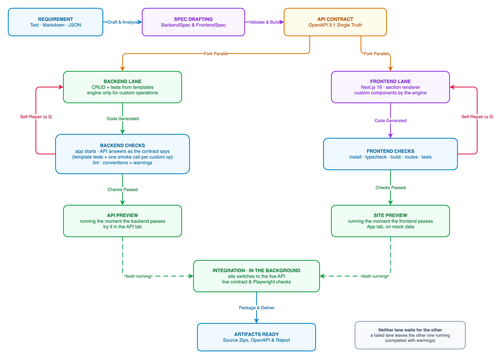
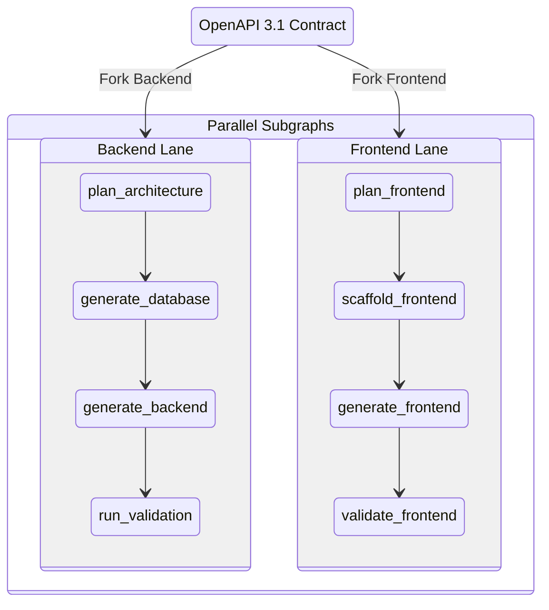
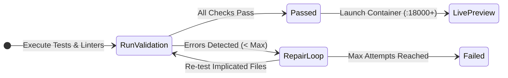

# Business Workflow Guide

This document describes the end-to-end business workflow of the **Fullstack Generation Agent**. It explains how a requirement moves from initial intake to a tested, fully containerized fullstack application with a live preview.

---

## 1. High-Level Lifecycle Overview

---

## 2. End-to-End Workflow Stages

### Stage 1: Requirement Ingestion
Developers or product managers provide application requirements through the Next.js Agent UI (`http://localhost:3100`) or the REST API (`POST /api/v1/generations`).

**Supported Inputs:**
1. **Natural Language / Markdown:** A plain text description or uploaded Markdown document (`.md`, `.txt`) detailing data entities, user journeys, workflows, or UI layouts.
2. **Frontend-Agent Site JSON:** An imported structured website specification containing page trees, sections, and mock seed data.
3. **Structured BackendSpec / FrontendSpec JSON:** Direct machine-readable JSON specifications conforming to the system's Pydantic schemas.

**Generation Modes:**
- **Dynamic Mode (`dynamic`)**: Fullstack generation. Generates a Next.js 16 App Router frontend and a FastAPI backend in parallel from a unified API contract.
- **Static Mode (`static`)**: Frontend-only generation. Generates a responsive, production-ready static Next.js website.
- **Backend Mode (`backend`)**: Backend-only generation. Generates a standalone FastAPI microservice with database models, migrations, and test suites.

**Engine Selection:**
- **Claude Code CLI** (Anthropic Claude 5.5 Sonnet)
- **Google Antigravity CLI** (`agy` with Gemini 3.8 models)
- **Fake Engine** (scripted deterministic replay for rapid end-to-end tests without API costs)

---

### Stage 2: Spec Drafting & Analysis
When requirements are submitted as text or markdown, the background worker invokes the `DraftRunner` outside the main execution graph.

1. **Schema Extraction:** The LLM analyzes the requirement to produce:
   - `backend-spec.json`: Entity definitions, relationships (1-to-many, many-to-many), field data types, CRUD actions, custom endpoints, and business rules.
   - `frontend-spec.json`: Page hierarchy, routing, form schemas, table structures, and data bindings.
   - `notes.json`: Architectural rationale, assumptions, and domain notes.
2. **Design Direction Selection:**
   - The engine evaluates curated design data (`.bga/design.md`) and selects a cohesive design direction (e.g. Modern Minimalist, Corporate Navy, Emerald Tech).
   - Generates theme tokens, color palettes, typography pairings (font families), and home page hero layouts.
   - Retains 3 alternative design directions so the user can switch visual themes during review.
3. **Asset & Image Resolution:**
   - **Real Photos**: Prompts image generation models (`gemini-3.1-flash-lite-image`) to synthesize real WebP photos for products, cards, and avatars.
   - **Vector SVG Assets**: Generates clean, accessible SVG illustrations matching the theme colors.
   - **User Uploads**: Binds user-provided images directly to section slots.

---

### Stage 3: Validation & Contract Review
Before code generation starts, the drafted specifications undergo automated validation:

1. **Schema Validation:** Checks that both specifications adhere to strict JSON Schema definitions via Pydantic v2.
2. **Cross-Spec Parity Check (`check_spec_pair`):**
   - Verifies that every UI data binding in `FrontendSpec` maps to a valid endpoint and property in `BackendSpec`.
   - Confirms all form submissions have corresponding POST/PUT endpoints and matching payload types.
3. **Single Source of Truth Contract:**
   - In dynamic mode, a pinned OpenAPI 3.1 contract (`.bga/contract.json`) is generated from the specification.
   - Both the frontend and backend are generated against this immutable contract.
4. **Interactive User Review:**
   - The user inspects the drafted specifications, entity relationships, and design directions in the Agent UI.
   - Users can edit fields, choose an alternative color palette, and approve the generation with one click.

---

### Stage 4: Parallel Generation Execution
Once approved, the LangGraph workflow executes. In dynamic mode, execution forks into two parallel lanes:

#### A. Backend Lane (`backend_lane`)
- **Fast Deterministic Codegen (No LLM):** Instantly generates SQLModel entities, Alembic migrations, repository ports/adapters, use cases, DTOs, and routers for all standard CRUD operations.
- **AI Coding Engine:** The LLM engine only implements custom business operations, domain validation rules, and specialized authentication logic.
- **Automated Tests:** CRUD tests come from the templates with the code (no engine writes tests); after startup,
  every custom operation is called once against seeded data and must answer as the contract says (Story 18.11).

#### B. Frontend Lane (`frontend_lane`)
- **Fast Deterministic Codegen (No LLM):** Generates TypeScript types (`T`-prefixed), Zod form schemas, React Query hooks (`useQuery`, `useMutation`), and MSW mock fixtures directly from the contract.
- **Standard UI Sections:** Built-in catalogue sections (Hero, Features, Pricing, Testimonials, Data Tables, Contact forms) are rendered deterministically.
- **AI Coding Engine:** Generates custom React components requiring specialized interactive logic.

---

### Stage 5: Sandbox Testing & Iterative Self-Repair
All generated code is validated inside isolated Docker sandbox containers:

1. **Backend Sandbox (`bga-runner`):**
   - Applies Alembic database migrations against a clean PostgreSQL database.
   - Runs `ruff` for linting, imports formatting, and style adherence.
   - Executes `pytest` across all generated unit and integration tests.
2. **Frontend Sandbox (`bga-runner-node`):**
   - Verifies TypeScript types with `tsc --noEmit`.
   - Runs `eslint` to enforce `nextjs-skills` conventions.
   - Executes `vitest` unit tests and synthetic rendering checks.
3. **Iterative Self-Repair:**
   - If linting or tests fail, the failure diagnostics (tracebacks, diffs, compiler errors) are packaged and fed to the engine's repair prompt (`repair_code` or `repair_frontend`).
   - The engine modifies only the implicated files.
   - Validation runs again. This loop continues until all checks pass or the maximum repair limit (default: 3) is reached.

---

### Stage 6: Integration, Live Preview & Delivery

1. **Contract Integration Check (`integrate`):**
   - The frontend is switched from MSW mocks (`MOCK_TEST_API=false`) to target the live backend container.
   - A headless Playwright browser runs smoke tests against the live frontend communicating with the real backend.
2. **Preview Container Launch:**
   - Docker launches the generated application in local preview containers allocated on ports `18000–18099`.
   - The user clicks **Open site** in the Agent UI to interact with their live application immediately.
3. **Artifact Packaging (`package_artifacts`):**
   - Bundles complete source code: `backend.zip` and `frontend.zip`.
   - Generates `openapi.json` contract and interactive Swagger/Scalar API explorer.
   - Generates `manifest.json` (SHA-256 digests, versions, toolchain) and `report.json` (test metrics, tokens, latency, cost).

---

## 3. Real-Time Observability & Monitoring

Throughout the entire process, developers have continuous visibility:

- **Server-Sent Events (SSE):** The Next.js UI streams live step state, active nodes, and log outputs in real time via `/api/v1/generations/{id}/events`.
- **Span Waterfall Tracing:** Every node execution, engine invocation, tool call, and sandbox command is recorded with start/end timestamps, input/output tokens, and dollar costs.
- **LangSmith Tracing:** Optional enterprise observability mirroring the entire execution graph to LangSmith.
