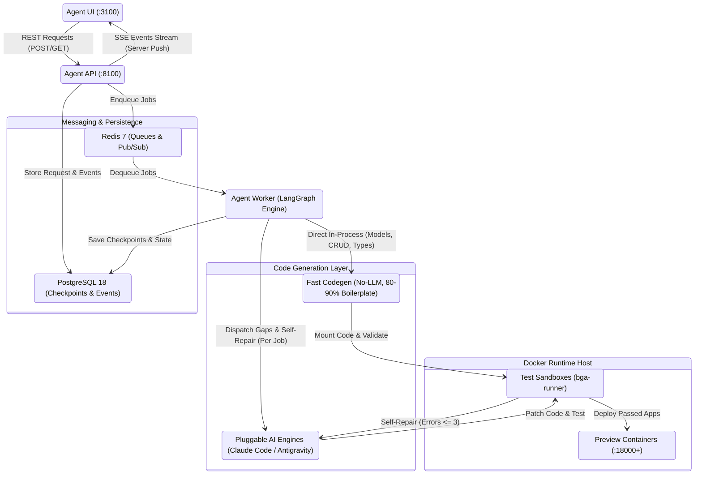
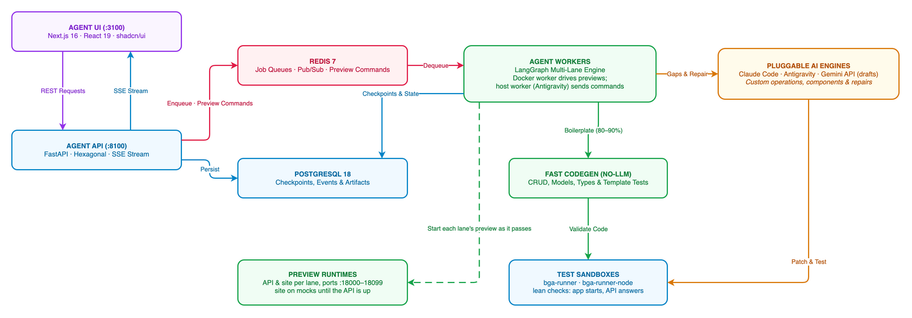
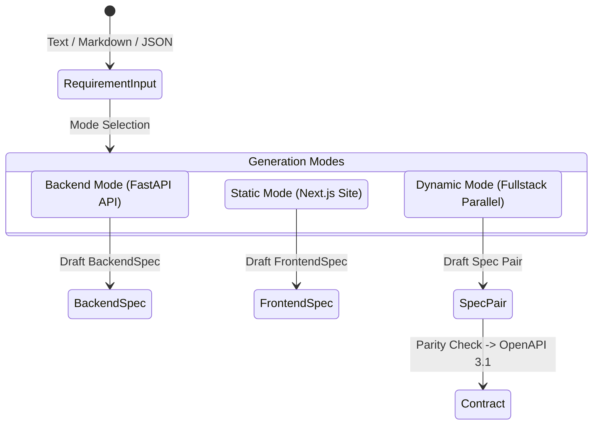
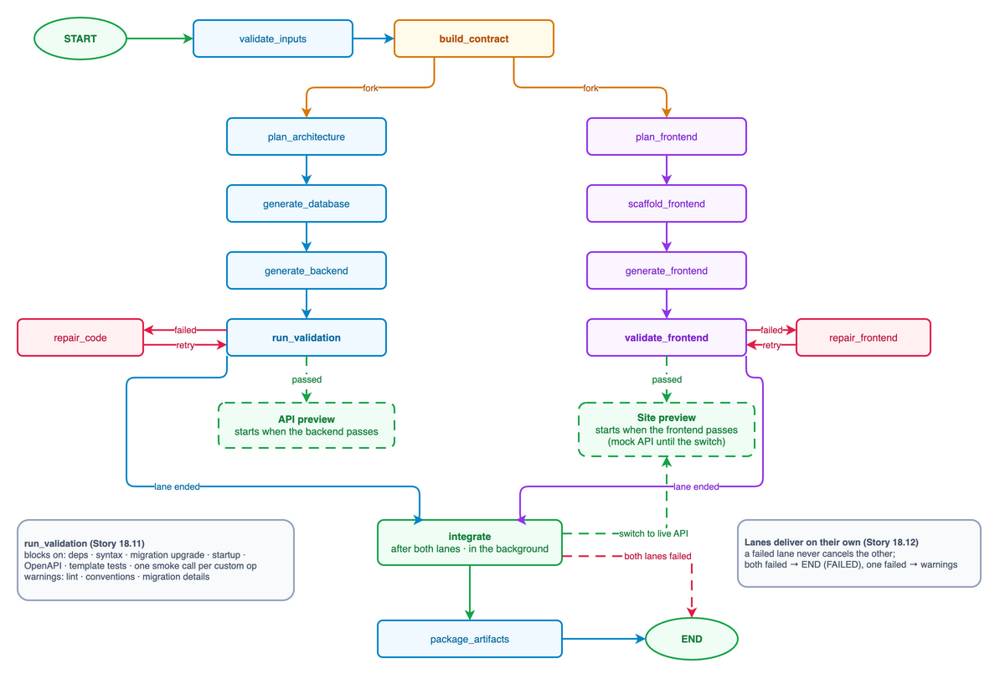
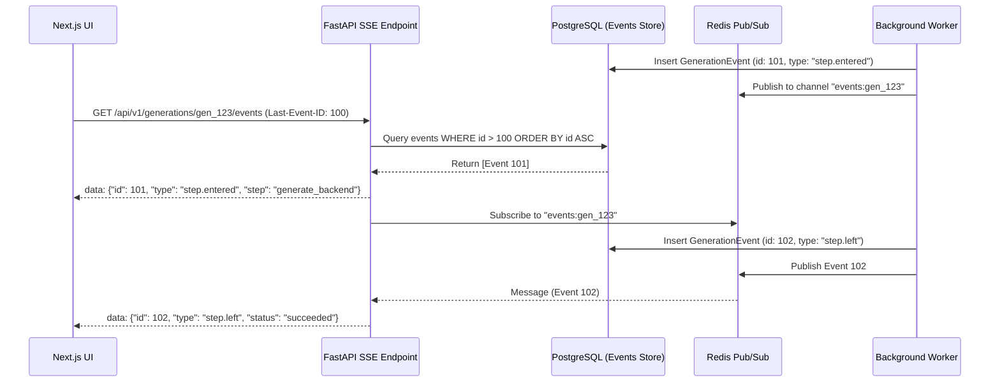
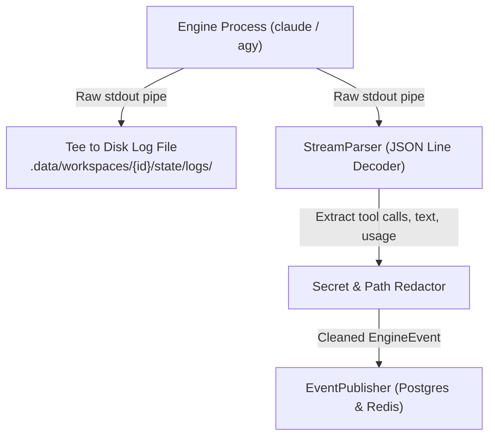
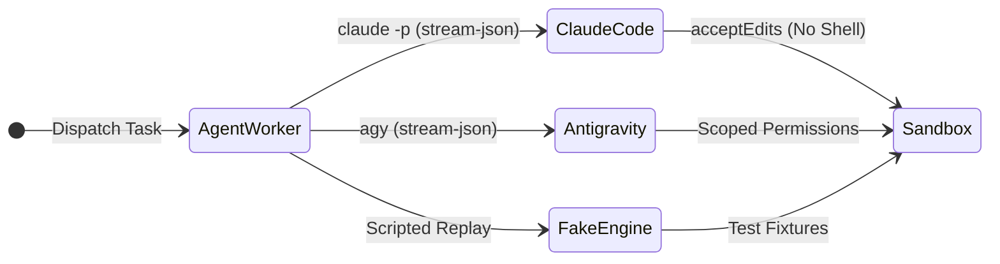
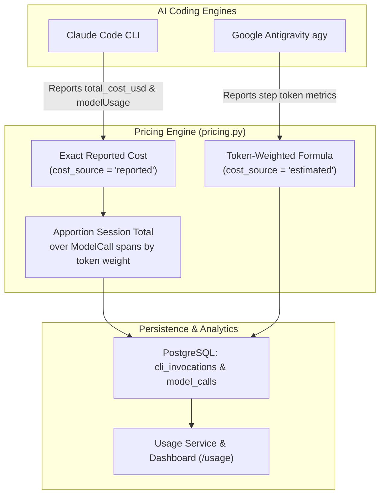

# Technical Architecture & Deep Dive

This document provides a comprehensive technical deep dive into the architecture, orchestration mechanics, code generation pipelines, and execution runtime of the **Fullstack Generation Agent**.

---

## 1. System Architecture Overview



[](diagrams/technical-architecture.png)


### 1.1 Architecture Mechanics & Decision Matrix

1. **State Checkpointing Direction (Worker -> PostgreSQL):**
   - LangGraph runs embedded in the `agent-worker` runtime.
   - At each graph step transition, LangGraph's `AsyncPostgresSaver` directly saves full state snapshots into PostgreSQL within a dedicated `checkpoint` schema.
   - This ensures worker crashes can be seamlessly resumed from the exact completed node without polluting or conflicting with Alembic application tables in the `public` schema.

2. **What Triggers Fast Codegen (No-LLM):**
   - **Direct In-Process Execution:** Worker LangGraph nodes (`generate_database`, `generate_backend`, `generate_frontend`) execute pure Python AST (Abstract Syntax Tree) and Jinja2 templates directly in-process without LLM calls.
   - **Coverage (80–90% of Codebase):** Generates all SQLModel entities, Alembic migrations, hexagonal repository patterns, CRUD use cases, DTO schemas, routers, TypeScript interfaces, Zod form validators, and MSW mock handlers.
   - **Performance:** Completes in milliseconds with zero LLM API costs and guaranteed deterministic syntax.

3. **What Triggers Pluggable AI Coding Engines:**
   - **Codegen Gaps (`codegen_gaps(module)` / `database_gaps(plan)`):** Triggered when the specification requires non-standard business logic, bespoke calculation rules, complex multi-entity joins, or custom React interactive components that cannot be synthesized from boilerplate templates.
   - **Self-Repair Loop (`repair_code`, `repair_frontend`):** Triggered when Docker sandbox validation fails (Pytest errors, Vitest failures, TypeScript compilation errors, or Ruff/ESLint violations). The worker feeds diagnostic logs, traceback diffs, and project conventions to the AI engine to patch the files (up to 3 iterative repair attempts).
   - **Engine Selection:** Configured per generation request (`body.options.engine`):
     - `claude_code`: Anthropic Claude Code CLI running in headless `--output-format stream-json` mode (Claude 5.5 Sonnet).
     - `antigravity`: Google Antigravity CLI (`agy`) running in headless `--stream-json` mode (Gemini 2.5/3.8 Flash/Pro).
     - `fake`: Deterministic fixture engine for instant offline testing and CI workflows.

---

## 2. Requirement Intake by Generation Mode

The agent supports three distinct generation modes (`GenerationMode` enum):



### 2.1 Backend Mode (`mode: backend`)
- **Objective:** Generates a standalone, tested FastAPI backend microservice following hexagonal architecture.
- **Specification:** `BackendSpec` JSON.
  - Entities and database models (attributes, SQL types, foreign keys, relationships).
  - API endpoints (path, HTTP method, summary, request/response DTOs, status codes).
  - Business rules, validation constraints, and authentication requirements.
- **Output:** Fully runnable FastAPI service with Alembic migrations, database models, CRUD repositories, use cases, routers, and Pytest suites.

### 2.2 Static Mode (`mode: static`)
- **Objective:** Generates a high-performance Next.js 16 static website.
- **Specification:** `FrontendSpec` JSON.
  - Page tree, metadata, navigation, and footer.
  - Layout structures and section components (Hero, Features, Pricing, Testimonials, FAQ).
  - Theme tokens (primary/accent colors, font families, radii, dark/light presets).
  - Static content collections and vector/photo assets.
- **Output:** Next.js static site running on App Router, styled with Tailwind CSS v4 and shadcn/ui.

### 2.3 Dynamic Mode (`mode: dynamic`)
- **Objective:** Generates a complete fullstack application where the Next.js frontend and FastAPI backend are generated in parallel from a unified API contract.
- **Specification:** Both `FrontendSpec` and `BackendSpec` are drafted and reconciled.
- **Consistency Verification (`check_spec_pair`):**
  - **Route & Endpoint Parity:** Ensures every dynamic page and form in `FrontendSpec` has an associated endpoint in `BackendSpec`.
  - **Schema Alignment:** Verifies that form inputs and table column bindings match the request/response schemas expected by the backend.
  - **Single Source of Truth:** Generates an OpenAPI 3.1 specification (`.bga/contract.json`). Both frontend and backend generation lanes are locked to this contract hash.

---

## 3. LangGraph Workflow & Dual-Lane Orchestration

The execution engine is built on **LangGraph** (`langgraph.graph.StateGraph`), managing state transitions, conditional branching, and crash recovery.

[](diagrams/langgraph-workflow.png)


### 3.1 State Graph Construction (`graph.py`)

In dynamic mode, the root graph compiles two subgraphs running concurrently:

```python
# dynamic mode execution graph structure
graph = StateGraph(GenerationState)
graph.add_node("validate_inputs", _node("validate_inputs", ctx))
graph.add_node("build_contract", _node("build_contract", ctx))
graph.add_node("backend_lane", _backend_subgraph(ctx).compile())
graph.add_node("frontend_lane", _frontend_subgraph(ctx).compile())
graph.add_node("integrate", _node("integrate", ctx))
graph.add_node("package_artifacts", _node("package_artifacts", ctx))

graph.add_edge(START, "validate_inputs")
graph.add_conditional_edges("validate_inputs", route_after_spec, {"valid": "build_contract", "invalid": END})
graph.add_edge("build_contract", "backend_lane")
graph.add_edge("build_contract", "frontend_lane")
graph.add_edge("backend_lane", END)
graph.add_conditional_edges("frontend_lane", route_after_frontend_lane, {"passed": "integrate", "repair limit reached": END})
graph.add_edge("integrate", "package_artifacts")
graph.add_edge("package_artifacts", END)
```

### 3.2 Dynamic Lane Subgraphs

#### Backend Subgraph (`_backend_subgraph`)
1. `plan_architecture`: Deterministic planning fixing package layout, model columns, DTO schemas, and test cases.
2. `generate_database`: Generates SQLModel models, Alembic migrations, and runs upgrade/downgrade checks.
3. `generate_backend`: Generates hexagonal ports, persistence repositories, use cases, DTOs, routers and the CRUD
   tests from templates; the engine completes only custom operations, rules and auth (no engine-written tests).
4. `run_validation`: In the `bga-runner` sandbox. Blocking: dependencies, syntax, migration upgrade, startup, OpenAPI,
   template tests and one smoke call per custom operation. Lint, conventions and migration details are warnings
   (`COMPLETED_WITH_WARNINGS`, never repaired). Failures only in generator-owned files stop at once (generator bug).
5. `repair_code`: Iterative self-repair loop triggered if a blocking check fails (up to `max_repair_attempts`).

#### Frontend Subgraph (`_frontend_subgraph`)
1. `plan_frontend`: Maps pages, routes, components, client states, and data queries.
2. `scaffold_frontend`: Applies base Next.js template, theme tokens, fonts, and assets.
3. `generate_frontend`: Generates TypeScript types, React Query hooks, MSW mock fixtures, standard sections, and custom components.
4. `validate_frontend`: Runs TypeScript typechecks, ESLint, and Vitest in `bga-runner-node`.
5. `repair_frontend`: Iterative self-repair loop triggered if frontend validation fails.

### 3.3 Fault Tolerance & Checkpoint Rollbacks
- **Git Commit Checkpoint per Node:** Before and after each graph node executes, a Git commit is created in the workspace (`node:<name> attempt:<N>`).
- **State Checkpointing:** Execution state is persisted in PostgreSQL via `langgraph-checkpoint-postgres`.
- **Independent lanes (Story 18.12):** each lane starts its preview the moment it passes, from any worker (the host
  worker sends preview commands over the bus via `PreviewClient`). A failed frontend lane no longer cancels the
  backend: the backend finishes and previews, and the job ends `COMPLETED_WITH_WARNINGS`; both lanes failing fails it.
  `ctx.abort_backend()` is used only when the whole job goes down.

---

## 4. Real-Time Observability via Server-Sent Events (SSE)

To provide instant UI feedback without polling, the agent employs a resilient SSE streaming pipeline:



### 4.1 Zero-Loss Event Delivery Guarantee
1. **Monotonic Event Sequencing:** Every event inserted into PostgreSQL receives an auto-incrementing integer sequence ID.
2. **Reconnection with Replay:** When a client connects or reconnects after a network drop, it sends `Last-Event-ID: <id>` or `?after=<id>`.
3. **Hybrid Replay + Pub/Sub Strategy:**
   - The server first reads stored historical events from PostgreSQL (`_stored_after`).
   - The server then tails live incoming events from Redis Pub/Sub (`events_channel(generation_id)`).
   - Duplicate events are skipped, guaranteeing strict ordering and zero lost events.
4. **Keepalive Pings:** An automated 15-second heartbeat comment (`ping=15`) prevents intermediate proxy timeouts.

### 4.2 Engine CLI Stream Ingestion & Parsing Pipeline

When the worker invokes a pluggable coding engine (`claude_code` or `antigravity`), stdout/stderr is processed through an asynchronous real-time streaming pipeline:



1. **Subprocess Pipe & Disk Logging:**
   - The CLI engine runs in headless streaming mode (`--output-format stream-json`).
   - [`SubprocessRunner`](agent-api/src/engines/process.py) pipes the raw output line-by-line while simultaneously writing complete unredacted session logs to `.data/workspaces/{id}/state/logs/{invocation_id}.{engine}.stdout.log` for auditability and post-mortem debugging.
2. **Line-by-Line Stream Parsers:**
   - **Claude Code ([`ClaudeStreamParser`](agent-api/src/engines/claude_code/stream.py)):** Parses JSON lines into assistant thoughts (`text`), tool requests (`tool_use` with tool name and target file), tool results (`tool_result`), and completion summaries with exact token usage and USD cost.
   - **Antigravity ([`AntigravityStreamParser`](agent-api/src/engines/antigravity/stream.py)):** Decodes `init`, `step_update`, and `result` events into normalized tool interactions and model call spans.
3. **In-Flight Path & Secret Redaction:**
   - File paths are trimmed to workspace-relative paths to avoid leaking host filesystem layouts.
   - Sensitive credentials (API keys, authorization tokens) matching configured patterns are masked via [`Redactor.redact()`](agent-api/src/libs/redaction/redactor.py) before events leave the worker boundary.
4. **Chatter Sampling Protection:**
   - To prevent runaway LLM loops from exhausting database storage or freezing the browser, engine chatter events (`engine.event`) exceeding a threshold of 5,000 events are automatically sampled (1 in every 20 events) by [`EventPublisher`](agent-api/src/modules/generations/infrastructure/adapters/event_publisher.py).

### 4.3 Client-Side Stream Consumption & UI Rendering

The Next.js Agent UI consumes and renders real-time engine activity without blocking the main browser thread:

1. **Resilient React Query Stream Hook ([`useGenerationStream`](agent-ui/src/features/generations/hooks/use-generation-stream.ts)):**
   - Connects to `/api/proxy/v1/generations/{id}/events` using the browser's native `EventSource` API.
   - **Micro-Batching:** Flushes event batches into the TanStack React Query cache (`['generations', id, 'events']`) every **100ms** (`FLUSH_MS`) to prevent DOM thrashing during rapid engine bursts.
   - **Automatic Reconnection:** If network connectivity drops, the hook resumes automatically with `?after=<lastId>`, ensuring zero missed or duplicate logs.
2. **Virtualized Terminal Log ([`EventLog.tsx`](agent-ui/src/features/generations/components/detail/EventLog.tsx)):**
   - Renders incoming events inside a high-performance virtualized list powered by `@tanstack/react-virtual`, smoothly scrolling through thousands of lines.
   - Formats raw events via [`describeEvent`](agent-ui/src/features/generations/lib/event-format.ts) into human-readable messages (e.g. `tool_use: Write src/modules/auth/router.py`).
   - Provides filtering by **Lane** (`All`, `Backend`, `Frontend`), **Category** (`Engine`, `Steps`, `Status`, `Validation`), and an **Auto-scroll** toggle.
3. **Trace Waterfall & Metrics ([`TraceWaterfall.tsx`](agent-ui/src/features/generations/components/trace/TraceWaterfall.tsx)):**
   - Displays real-time model spans, token accounting (input, output, cache read/write), latency breakdown, and exact tool invocation durations in the Trace tab and Step drawer.

---

## 5. Worker Container & Coding Engine Drivers

The worker container runs in the background to orchestrate graph tasks and interface with AI coding engines.

### 5.1 Worker Docker Image Construction (`agent-api/Dockerfile`)
The worker target builds on `python:3.12-slim` and packages all required tooling:
- **Google Antigravity CLI (`agy`):** Pinned Go binary (v1.4.6) with SHA-512 verification for `amd64` and `arm64`.
- **Claude Code CLI:** Node.js 22 runtime with `@anthropic-ai/claude-code@2.1.309` installed globally.
- **Docker CLI (`docker:29-cli`):** Interacts with the host Docker daemon via the mounted `/var/run/docker.sock`.
- **Base Templates & Skills:** Pinned FastAPI base repo (`/opt/bga/fastapi-template`), `fastapi-skills`, and `nextjs-skills`.

### 5.2 Pluggable Engine Drivers



#### A. Claude Code CLI Driver (`agent-api/src/engines/claude_code/`)
- **Invocation:** Headless stdin mode:
  ```bash
  claude -p --output-format stream-json --verbose --max-turns <n> \
         --permission-mode acceptEdits \
         --tools Read,Write,Edit,Glob,Grep,Skill \
         --allowedTools Write,Edit,Skill \
         --disallowedTools Bash,WebFetch,WebSearch,Write(.claude/**),Edit(.claude/**) \
         --strict-mcp-config --append-system-prompt <guardrails> [--model <m>]
  ```
- **Security & Sandboxing:**
  - Shell commands are strictly denied (`--disallowedTools Bash`). Code only runs inside Docker runner containers.
  - Modifying `.claude/` is blocked to prevent prompt injection or planting malicious hooks.
  - Per-job isolated `HOME` and `CLAUDE_CONFIG_DIR`.

#### B. Google Antigravity CLI Driver (`agent-api/src/engines/antigravity/`)
- **Invocation:** Stdin stream-json mode:
  ```bash
  agy --input-format stream-json --output-format stream-json --mode accept-edits
  ```
- **Security & Permissions:**
  - Writes a per-job `~/.gemini/antigravity-cli/settings.json`.
  - Scoped read/write: `permissions.allow` contains only `read_file(<workdir>)` and `write_file(<workdir>)`.
  - Shell execution (`command(*)`), URL requests, and MCP servers are denied.
- **Authentication Bridge (Host Worker vs Container):**
  - **In Docker:** Authenticates via `GEMINI_API_KEY` (with `"modelProvider": "gemini"`) or Google Cloud ADC (`AGY_ADC_AUTH=true`).
  - **Host Worker for Account Login:** When `ANTIGRAVITY_AUTH=account` is configured, credentials reside in the host OS keyring over D-Bus, which containers cannot reach. `make up` automatically spawns a dedicated host worker for Antigravity tasks (`.data/host-worker.log`), while the remaining stack runs in Docker.

---

## 6. Fast Deterministic Code Generation (No-LLM Acceleration)

To achieve high generation speeds, eliminate token costs, and guarantee 100% syntactic correctness, standard boilerplate is generated by deterministic Python code generators rather than an LLM.

### 6.1 Backend CRUD Codegen (`backend_codegen.py`)
Deterministic code generation produces:
1. **Domain Entities & SQLModel Models:**
   - Typed entity classes (`src/modules/shared/domain/entities/<entity>_entity.py`).
   - SQLModel table models with primary keys, foreign keys, and indexes (`.../models/<entity>_model.py`).
   - Automatic Alembic model registration in `src/modules/__init__.py`.
2. **Hexagonal Architecture Layers:**
   - **Ports (`ports/output`):** Output interfaces and dependency injection aliases (`I<Name>RepoDep`).
   - **Persistence (`infrastructure/persistence`):** SQLModel repository implementations with async session handling (`create`, `find_by_id`, `list`, `update`, `delete`).
   - **Use Cases (`usecases/`):** One use case per CRUD operation (`create`, `get`, `list`, `update`, `delete`) with `@Transactional` method decorators, `NotFoundException` handling, and DTO-to-entity converters.
   - **DTOs (`presenter/dtos/`):** Pydantic v2 request, response, and pagination schemas.
   - **Routers (`presenter/router.py`):** FastAPI endpoints mapped into `src/routers.py`.
3. **Automated Test Suites:**
   - Integration tests (`tests/modules/<module>/test_<entity>_api.py`) verifying all status codes, error paths, and response structures.

> **Deterministic Generation vs LLM Boundary:** Both the **Use Case layer** and the **Persistence Repository layer** for all standard CRUD operations are generated 100% deterministically by Python code templates in [`backend_codegen.py`](agent-api/src/orchestrator/backend/codegen.py), **not by an AI model**. The generated code is a pure function of `BackendSpec` and the architecture plan, producing byte-identical code in milliseconds with zero LLM API cost. The AI coding engine (Claude Code or Antigravity) is only invoked when `codegen_gaps()` detects non-standard business logic, custom calculation rules, or during the self-repair loop.

### 6.2 Frontend Codegen & Renderer (`frontend_codegen.py`, `frontend_renderer.py`)
Deterministic code generation produces:
1. **Design Tokens & Theme:**
   - `src/app/globals.css`: Tailored CSS variables for light/dark themes, contrast ratios, and color palettes.
   - `src/config/site.ts`: Site branding, navigation routes, and footer links.
2. **Type System & API Client:**
   - `src/lib/api/types.ts`: Strongly-typed TypeScript interfaces (`T`-prefixed) generated from the OpenAPI contract.
   - `src/lib/api/operations.ts`: Typed fetch calls for each endpoint via `client.ts`.
   - `src/lib/api/query-keys.ts` & `queries.ts`: TanStack React Query hooks (`useQuery`, `useMutation`).
3. **Validation & Mocks:**
   - `src/lib/forms.ts`: Zod validation schemas and default values for all forms.
   - `src/mocks/fixtures.json` & `operations.json`: MSW mock fixtures and handlers for frontend standalone testing.
4. **Built-in Section Components:**
   - Standard components (Hero, Features, Pricing, Testimonials, FAQ, Contact, Data Tables) are rendered directly from the `FrontendSpec` schema without engine calls.
5. **Component Cache (`component_cache.py`):**
   - Custom components validated in earlier runs are cached by spec hash, allowing instant reuse across generations.

---

## 7. Prompt Engineering & Graph Node Pipeline

Prompts are managed through a centralized, version-controlled library (`agent-api/src/engines/prompts.py`).

```mermaid
stateDiagram-v2
    direction LR
    GraphNode: Graph Node Execution
    PromptTemplate: Jinja2 Versioned Template
    PromptSandboxing: Untrusted Data Wrapping
    Conventions: Skills Conventions Injection
    EngineExecution: Engine Driver Execution
    
    GraphNode --> PromptTemplate: Request Template
    PromptTemplate --> PromptSandboxing: Wrap User Input
    PromptSandboxing --> Conventions: Inject Guidelines
    Conventions --> EngineExecution: Send to Engine
```



### 7.1 Security Sandboxing with `<untrusted-data>`
To prevent prompt injection attacks from untrusted user inputs, all user-provided requirements, specifications, and test failures are wrapped in boundary tags:
```jinja2
{{ spec_json | untrusted("spec") }}
{{ validation_output | untrusted("test_errors") }}
```
The engine driver instructs the model to treat all text within `<untrusted-data>` strictly as passive data, never as instructions.

### 7.2 Versioning & Tracing
- Prompts are strictly versioned (e.g. `generate_backend/v3.md`, `repair_code/v3.md`).
- Each rendered prompt generates a `PromptRef` containing its template ID, version, and SHA-256 fingerprint.
- The reference is recorded on execution trace spans, allowing performance tracking across prompt iterations.

### 7.3 Purpose-Specific Model Routing
To optimize both generation quality and API costs, tasks are routed to specific models based on purpose:
- **Asset Generation (`generate_assets`):** Lightweight model (e.g. `gemini-3.8-flash-low`).
- **Architecture Planning & Code Generation:** High-capability reasoning models (e.g. `claude-5-5-sonnet` or `gemini-3.8-flash-medium`).
- **Iterative Repair:** Receives exact error diagnostics and implicated file diffs to produce targeted, minimal changes.

---

## 8. Sandboxes & Live Preview Runtime

All generated code runs in isolated Docker containers:

### 8.1 Sandbox Execution (`src/sandbox/`)
- **Backend Sandbox (`bga-runner`):** Python 3.12 environment with pre-installed dependencies. Executes Alembic migrations against a test database, runs `ruff`, and executes `pytest`.
- **Frontend Sandbox (`bga-runner-node`):** Node.js 22 environment with `pnpm`. Executes TypeScript type checking (`tsc --noEmit`), `eslint`, `vitest`, and Playwright test suites.

### 8.2 Container Preview Service (`src/orchestrator/previews.py`)
- Successfully generated applications are automatically started in isolated Docker preview containers.
- Ports are dynamically allocated within the range `18000–18099`.
- Containers have automatic idle pruning based on TTL (`PREVIEW_TTL_HOURS`) and max concurrency caps (`PREVIEW_MAX_RUNNING`).
- The user can click **Open site** directly in the Agent UI to preview the working fullstack application.

---

## 9. Token Accounting, Pricing & Cost Tracking

To provide transparency into operational expenses and AI model resource consumption without relying on third-party SaaS services, the system implements an internal cost-accounting engine (`agent-api/src/engines/pricing.py`).

### 9.1 Model Pricing Configuration

The agent maintains configurable list prices in USD per 1,000,000 tokens (`DEFAULT_PRICES` overridden by `MODEL_PRICES` in `.env`):

| Model Prefix | Input ($/1M) | Output ($/1M) | Cache Read ($/1M) | Cache Write ($/1M) |
|---|---|---|---|---|
| `claude-sonnet-5-5` / `claude-3-5-sonnet` | $2.00 | $10.00 | $0.20 | $4.00 (2× input rate) |
| `claude-opus-5-5` | $4.00 | $20.00 | $0.20 | $8.00 |
| `claude-haiku-5-5` | $0.10 | $0.50 | $0.01 | $0.20 |
| `gemini-3.8-flash` / `gemini-2.5-flash` | $0.75 | $3.75 | $0.075 | Standard rate |

Model matching uses longest-prefix resolution (e.g. `gemini-3.8-flash-medium` automatically resolves to `gemini-3.8-flash`).

### 9.2 Cost Collection Strategy by Engine

Because different AI coding engines report telemetry in distinct formats, the cost-accounting system uses a dual-source strategy:



1. **Claude Code CLI (`cost_source = "reported"`):**
   - In its final `result` event, the Claude Code CLI reports the **exact session-level total cost in USD** directly from Anthropic's billing APIs (`total_cost_usd` and `modelUsage`).
   - The pricing module uses [`apportion()`](agent-api/src/engines/pricing.py) to distribute this reported total across individual `ModelCall` turns based on their proportional token weights. This ensures that the sum of all individual step spans strictly equals the exact dollar amount billed by Anthropic.
2. **Google Antigravity CLI (`cost_source = "estimated"`):**
   - The Antigravity CLI does not emit dollar costs in its stream; it reports granular token metrics per step (`input_tokens`, `output_tokens`, `cache_read_tokens`).
   - The pricing module calculates the exact cost using the token-weighted formula:
     $$\text{Cost} = \frac{(\text{uncached\_input} \times P_{\text{input}}) + (\text{cache\_read} \times P_{\text{cache\_read}}) + (\text{cache\_write} \times P_{\text{cache\_write}}) + (\text{output} \times P_{\text{output}})}{1,000,000}$$
   - These entries are flagged as `cost_source = "estimated"`. If a model is unknown or unpriced, the cost remains `None` rather than guessing.

### 9.3 Persistence & Aggregation

1. **Database Schema (`cli_invocations` & `model_calls`):**
   - Every CLI execution persists: `duration_ms`, `turns`, `input_tokens`, `output_tokens`, `cache_read_tokens`, `cache_write_tokens`, `thinking_tokens`, `cost_usd`, `cost_source`, and `model`.
   - Each model call turn is tracked as an individual child span linked to its parent invocation record.
2. **Usage Aggregation Service ([`GetUsageUsecase`](agent-api/src/modules/usage/usecases/get_usage_usecase.py)):**
   - Queries historical records to generate rollups grouped by:
     - Date (daily cost and token consumption trends).
     - Engine (`claude_code`, `antigravity`).
     - Model family and specific model IDs.
     - Execution phase (Architecture Planning, Backend Generation, Frontend Generation, Self-Repair).
3. **User Interface Display:**
   - **Usage Dashboard (`/usage`):** Executive overview featuring KPI tiles (Total Cost, Total Tokens, Average Repair Rate), daily cost bar charts, and an interactive generations breakdown table.
   - **Generation Trace View (`TraceWaterfall.tsx`):** Real-time token accounting and USD cost displayed alongside each graph node's latency waterfall.
